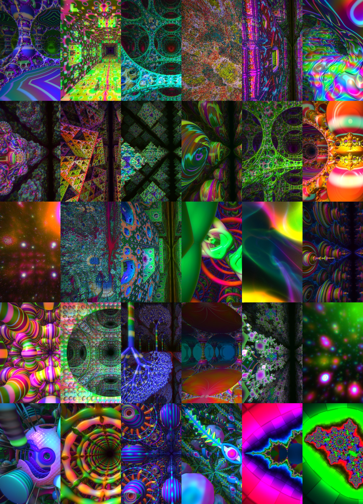

# Mirrorfold

> [!WARNING]
> **Photosensitivity, seizure and motion warning. Please read before use.**
>
> Mirrorfold shows constantly changing colour, moving patterns, pulsing light and fast simulated motion. A small number of people have seizures, blackouts or other reactions when they see visuals like these, **even if they have never had a seizure before**.
>
> - **Do not use Mirrorfold** if you or anyone watching has epilepsy, has ever had a seizure, or is sensitive to flashing light, patterns or motion, unless a doctor has said it is safe.
> - **Stop at once and look away** if you notice dizziness, blurred or altered vision, eye or muscle twitching, confusion, disorientation, nausea, headache, or any involuntary movement. Get medical help if it does not pass.
> - Simulated flight can cause motion sickness. The VR viewer makes this more likely. Use it seated, and take breaks.
> - To lower the risk: use it in a well-lit room, sit back from the screen, prefer a smaller screen, keep sessions short, and do not use it when tired. Turning on your device's "reduce motion" setting makes Mirrorfold calmer.
> - Video, audio and packs that you load yourself are outside the project's control and can add flashing or intense motion of their own.
>
> Mirrorfold is designed to avoid strobing, but it has **not** been tested or certified against any photosensitivity standard, and no setting makes it safe for everyone. It is not a medical device and nothing here is medical advice. It is provided "as is", without warranty of any kind, and you use it entirely at your own risk; see the [licence](LICENSE).

Fly through endless fractal worlds in your browser. Thirty worlds, kaleidoscope mirrors, feedback trails, filters, overlays, and an autopilot that reacts to music.

This project is inspired in part by the music visualizers from decades past… from Winamp plugins to the standalone visualizer MilkDrop. This has a familiar feel when in Journey mode (an autopilot that flies through the procedurally generated 3D worlds) while listening to music. 

However, this is much more. Flying through fractal 3D landscapes, unlocking features by flying through Orbs, and tweaking so many settings is a relaxing and beautiful time sink, whether on your phone or PC. 

Support for Google Cardboard like VR is also in development (very early stage) and full VR support for true VR headsets is on the way. 

You can Cast or AirPlay your mobile device to your TV as well. 

This is under active development so don’t be surprised if things change from underneath you when I get a hankering for new features. 

Report bugs and discuss features and whatnot in GitHub issues. I’ll try to address them in a timely fashion but this is a small creative side project that itches a scratch for me and I just thought I’d share it with the world. 

Relax, unwind, and enjoy!

**Try it: https://gcrabtree.github.io/MirrorFold/**



The app is one page, one stylesheet and a folder of JavaScript modules. There is no build step and no JavaScript dependency. It uses WebGL 1, so it runs in any current browser on a phone or a desktop.

## Contents

- [What it does](#what-it-does)
- [Run it](#run-it)
- [Controls](#controls)
- [The buttons](#the-buttons)
- [The land](#the-land)
- [On a TV](#on-a-tv)
- [VR viewer](#vr-viewer)
- [Music](#music)
- [Journey](#journey)
- [The zoom worlds](#the-zoom-worlds)
- [The lessons](#the-lessons)
- [Orbs and share links](#orbs-and-share-links)
- [Performance](#performance)
- [Motion and privacy](#motion-and-privacy)
- [How it works](#how-it-works)
- [Developing](#developing)
- [What has not been tested](#what-has-not-been-tested)
- [Licence](#licence)

## What it does

- **30 worlds.** Twenty-five are solid surfaces, all fractals but Cell (the inside of a living cell), Biomech, Seer and Net (see below); three (Nebula, Aurora and Lanterns) are glowing volumes; two (Mandelbrot zoom and Julia zoom) are flat pictures seen from above that zoom in and out. Every world you fly through repeats forever in all directions.
- **Biomech**, a world in homage to the biomechanical paintings of H. R. Giger: an endless hall of tunnels whose walls are rib cages, with spines where the tunnels meet, tendons between ribs and spines, and ribbed hoses running alongside. The cages breathe with the morph. Nothing of his is copied; it is built from the kinds of thing he painted. With it come three near-grey palettes that are open from the start (**Gunmetal**, **Tallow**, **Verdigris**), the **ribbed** surface, the **Airbrush** filter and the **Biomech** journey template, all of which work in every other world too.
- **Zooms a trillion times deep.** The two zoom worlds magnify the Mandelbrot set and Julia sets up to about a trillion times, on points where there is always something to see. See [The zoom worlds](#the-zoom-worlds).
- **Free flight** in any direction, with roll. Your speed drops as you approach a surface, so you can never hit a wall.
- **Morph.** Each world changes shape as you fly. With music playing, the song decides the shape: a quiet passage opens the world out, a full one folds it dense, and a drop gives a surge forward.
- **Kaleidoscope mirrors**: off, or 3, 4, 6, 8 or 12 segments.
- **14 colour palettes.** Eight are available from the start (one of them, Wood, is browns). Six are unlocked by finding orbs.
- **A picture beside every name.** The world, palette, motion, filter, overlay, mirrors, FX and landscape buttons each open a grid of small pictures that show what each choice looks like.
- **Seer**, a world in homage to the visionary paintings on the band Tool's records and stage, Alex Grey's among them: an endless lattice of eyes that look both ways, each between two lids in a sun of fourteen flames with a beaded halo, and seven-pointed stars in rings in the spaces between. The pupils are holes, so a row of eyes can be seen through the eye in front, and flown through. The morph opens the pupils, narrows the lids and sways the flames. Nothing of theirs is copied; it is built from the kinds of thing those pictures are full of. With it come the **Vision** palette (gold through violet to deep blue, open from the start) and the **Visions** journey template.
- **Net**, a second world in the same homage, nearer to those paintings: a net of strands fringed with flames that fills space, with an almond eye set into the middle of every strand, looking out both ways, and a pale ball of cloud in every large gap. Cut flat along the axes the net is diamonds. The morph lengthens the flames and opens the pupils. Nothing of theirs is copied; it is built from the kinds of thing those pictures are full of. With it come the **Cobalt** palette (deep blue to pale silver-blue and nothing else, open from the start); it is in the Visions template too.
- **6 feedback motions, 23 filters, 10 overlays and 8 transitions**, in the style of the MilkDrop music visualiser.
- **Music reactivity** from a built-in track, your own audio file, another browser tab such as Spotify or YouTube, the microphone, or a tapped tempo.
- **Journey**, an autopilot that flies for you and changes the world, palette, mirrors, motion, filter, overlay, surface, land, packing, pulse and shapes over time. You control what it may change with templates.
- **Share spot** links that take someone to the exact place you are looking at.
- **Record flight**: a link that flies someone else along the path you flew, through the same changes of world and look, drawn afresh on their device. They have the controls the moment they move.
- **Packings** for the eight worlds made of one shape repeated (Citadel, Bulbs, Shards, Crystal, Julia, Hive, Mandelbrot, Pyrite). **Grid** sets the copies out in straight rows with flat lanes between them. **Scattered** moves each copy off its place, turns it its own way and leaves some places empty. **Nested** does that with copies of three sizes, the small ones filling the room between the large. **Sponge** sets small copies out as a sponge with square holes through it, with a large copy at the heart of each block. **Helix** winds two strands of copies up round an open middle you can fly along. **Shells** has cages of twenty copies one inside another round a centre, each a third the size of the one outside it. **Descent** is one such nest with no end either way: fly in toward the middle and the small cage ahead grows until it is the large one, with small ones inside it again, for as long as you like.
- **Pulse and Shapes**, two more choices for those worlds in every packing but the grid. **Pulse together** has every copy change shape at once, as before; **Pulse wave** puts each copy a little behind its neighbour, so a change of shape passes through the field. **Shapes mixed** gives each copy one of three kinds of shape, the world's own and two others, in place of all one kind.
- **Chrome**, a surface that shows the other shapes in it.
- **Inside out**: open space and solid swapped, so you fly where the shapes were and the old open space is the walls.
- **The light wave**: on a beat, a band of light runs outward from you over the shapes, so the music is seen to reach the far ones a moment later.
- **Light shafts**: a haze in the open space that is lit only where the way to the light is clear, so light falls in beams through the gaps.
- **Photo mode**, with sliders for zoom, brightness and focus and a much larger picture than the screen; and **postcards**, a picture with the spot's code under it as letters to type and a QR code to scan.
- **Doorways**: a ring of light standing in one world, with another world showing through it. Fly through and you are there, with no cut. Journey changes world this way when it is flying.
- **Strange doorways**, which lead back into the world you are in, changed: close up to the surface ahead, where you come out small among large shapes, or upside down, or mirrored.
- **Ribbons**: your flight leaves a line of light behind it, and so does a friend's.
- **Fly together**: up to four people in the same world, each seen by the others as a ring of light. One link joins a friend; after that the browsers talk straight to each other.
- **The eye**: a human eye over the whole picture, with the world in its pupil, an iris that changes shape and takes the palette's colours, pores round it that open and shut with the beat, and a blink that can change the world.
- **Hold still**, a pause that sharpens the picture, with **Lens blur** to soften what is nearer and further than the middle of the view; **Save picture**, which saves a picture that opens again as the scene it shows; **Record video**; and **Record a loop**, a flight that ends exactly where it began, saved as a video that repeats with no join.
- **A gallery** of journeys and packs that people have shared, and a way to offer your own.
- **A light to throw**, which bounces off the surfaces of the world.
- **VR viewer** mode for a phone in a Cardboard-style holder: a picture for each eye, and you look around by turning your head.

The worlds, in menu order: Lattice, Sponge, Halls, Box, Citadel, Coral, Bulbs, Shards, Crystal, Julia, Web, Temple, Nebula, Fortress, Hive, Gates, Aurora, Mandelbrot, Tangle, Foam, Thicket, Kleinian, Pyrite, Lanterns, Mandelbrot zoom, Julia zoom.

The six added last: **Tangle** is pipes that never end, **Foam** is a frame pitted with round holes, **Thicket** is branching trees, **Kleinian** is a hall of lace columns between a floor and a ceiling, **Pyrite** is cubes with smaller cubes on their corners, and **Lanterns** is soft lights hanging in the dark.

## Run it

**Online:** open https://gcrabtree.github.io/MirrorFold/.

**From a copy of this repository:** run `python3 -m http.server` in the folder and open `http://localhost:8000`. Opening `index.html` straight from the file system no longer works, because browsers do not load JavaScript modules that way.

**From a local web server:**

```
python3 -m http.server 8000
```

Then open http://localhost:8000/.

**Host your own copy:** put `index.html`, `css/` and `js/` (and `packs/` if you want the starter pack offered) on any static web host. For GitHub Pages, keep them at the root of the published branch and keep the empty `.nojekyll` file, which stops Pages from running Jekyll over the repository.

On the start card, choose **Enter with music** or **Enter silent**.

### Full screen

On a desktop, Android or iPad, press the **Fullscreen** button.

Safari on iPhone does not let a web page go full screen, so the button is hidden there. Instead, add Mirrorfold to your home screen: open the site in Safari, press the Share button, then **Add to Home Screen**. Opening it from the new icon runs it without Safari's bars. The home-screen copy keeps its own saved templates and orb progress, separate from Safari's; save a pack file from the Library to move templates across.

## Controls

### Phone or tablet

| Action | Gesture |
|---|---|
| Move | Left thumb, anywhere in the left 45% of the screen. A ring appears under your thumb. |
| Look | Right thumb, anywhere else. |
| Change speed | Two fingers on the right side, pinch. |
| Roll | Two fingers on the right side, twist. |
| Burst of speed | Double-tap on the right side. |

### Mouse and keyboard

Click the picture to capture the mouse. Where the browser does not allow that, drag to look.

| Action | Key |
|---|---|
| Fly | `W` `A` `S` `D` |
| Up, down | `Space`, `Shift` |
| Roll | `Q`, `E` |
| Look | Mouse, or arrow keys |
| Change speed | Mouse wheel |
| Burst of speed | `B`, or double-click |
| Next or previous world | `]`, `[` |
| Jump to one of the first nine worlds | `1` to `9` |
| Next palette | `P` |
| Next mirror setting | `M` |
| Journey on or off | `J` |
| Tap tempo | `T` |
| Hold still | `H` |
| Throw a light | `G` |

The controls at the top of the screen fade after five seconds without input and come back on any touch or click.

## The buttons

The controls fade after five seconds and come back when you touch the picture.

**First row:** World, Palette and Music. **World** and **Palette** each open a chooser: a grid of small pictures, one for each choice, with its name under it. Press a picture to choose it; **Close**, the Escape key or a press beside the grid leaves things as they were. Motion, Filter, Overlay, Mirrors, FX and the landscape button open the same kind of chooser. A world, palette, motion, filter or overlay that came from a pack has no picture: a palette shows a stripe of its colours, the others say so.

**Second row:** three buttons, then four that each open a group of controls under the row, then **How it works**, which opens [the lessons](#the-lessons). One group is open at a time; pressing its button again closes it, and it closes when the controls fade.

| Button | What it does |
|---|---|
| Journey | Turns the autopilot on or off. |
| Hold still | Stops everything that moves by itself: the clocks, the breathing of the world, the drift and Journey. You can still look and fly by hand. Whenever you are not moving, the picture sharpens over about a second, because each frame looks through a different part of every pixel and the frames are averaged. Key **H**. Turning Journey on lets go. |
| Lens blur | Off, soft or strong. It shows while **Hold still** is on and you are not moving: whatever is in the middle of the picture stays sharp, and what is nearer or further softens, as in a photograph taken close up, so the shapes look small enough to hold. The picture takes two or three seconds to settle, because it is the average of many frames, each seen from a different place on a lens. If the middle of the picture is empty distance, the nearest things are the sharp ones. It is not shown in the zoom worlds, over the land or in the VR viewer. In the Look group. |
| Throw a light | Sends a small glowing ball ahead of you. It flies straight, bounces off the surfaces, loses a fifth of its speed at each bounce and shrinks away after twenty seconds. Throwing again takes it back. Not in the three cloud worlds, in a world from a pack, or with the land alone. Key **G**. |

**Look**

| Control | What it does |
|---|---|
| Feedback motion | none, Melt, Vortex, Tunnel, Implode, Ripple, Drift. Each one smears the previous frame in a different way. |
| Filter | none, Echo, Neon, Solar, Negative, Poster, Mosaic, Liquid, Prism, Quad, Tiles, Bulge, Twirl, Thermal, CRT, Halftone, Contour, Noir, Comic, Two-tone, Tape, Streaks, Emboss, Glass, Airbrush. The six before Airbrush were made with video in mind. **Airbrush** takes nearly all the colour out and leaves the light: cool in the shadows, warm in the highlights, as if the picture were sprayed in greys. |
| Overlay | none, Ring, Scope, Spectrum, Spokes, Rings, Spiral, Orbit. These draw the sound on top of the picture. **Dancer**, **Chorus line** and **Dance floor** are stick figures that dance to the music: one, who goes all over a floor that runs away from you, growing smaller with distance and never larger than at its front edge; four doing the same dance together; a crowd of eight to twelve standing at different depths, the further ones smaller and drawn behind the nearer, each with a dance of its own. They are drawn as a person's body would look in a suit of lines, with shoulders, hips, hands and feet, and have 143 named moves, among them the step touch, the twist, the mashed potato, the hand jive, the macarena, Y M C A, the time warp, the electric slide, the moonwalk, the running man, the sprinkler, the floss, the dab, the can-can and a turn of Riverdance. They keep time with the beat, choose livelier moves as the music fills, dance only to a steady beat, which they find in whichever part of the sound has it (the kick drum, the claps or the hi-hats): while the music is quiet, when there is none, or when there is sound without a beat (someone talking before a song starts, say) they stand about shifting their feet or walk to and fro, and go back to their places when the beat comes, face any way and not only toward you, give at the knees on each kick of the bass, dance a routine of three to ten moves that go together and come back to it before making another, take a new routine when the sound changes greatly, sway at the hips, shift their weight and shuffle their feet whatever the move, hit with their arms on the kick, never do a move quite the same way twice, move about the floor and turn slowly on the spot as they dance, so that they are seen from every side (the moonwalk glides backward), and all jump when a drop lands. With **Tap tempo** they dance to your taps. With **Stats** on, a line says what they hear: how much they are dancing, how sure the beat is, and whether there is sound. They stay as they are in **Hold still** and are not drawn while a loop is flown. |
| Overlay strength | 15%, 30%, 50%, 75% or 100%. |
| Mirrors | Opens a chooser: off, 3, 4, 6, 8 or 12 segments. The M key steps through them. |
| FX | Opens a chooser: glow, trails or clean. Sets the base amount of trail and bloom. |
| Surface | Opens a chooser of what the worlds' surfaces are made of, all in the palette's colours. **Plain** gives each part of a shape one colour. **Grain** is the rings of a tree, as if every shape were carved from a block of timber (choose the palette Wood for browns); the rings' waves drift slowly, grow with the music and step on the beat. **Dots** are round dots with a dark border that grow on the beat. **Tiles** are blocks of different shades with dark joints, and some light up with the high notes. **Marble** is pale stone with dark veins that drift and thicken on the beat. **Wire** is a dark surface with a glowing grid that brightens on the beat. **Cells** are irregular patches with dark edges that widen on the beat. **Pearl** is a sheen whose colour slides over a shape as you pass. It changes the solid worlds only: the three glowing worlds and the two zoom worlds have no surfaces. **Ribbed** covers every surface in fine ridges like the rings of a hose, takes most of the colour out and makes it shine, so shapes read as dull metal or bone. **Chrome** is dark polished metal that shows the other shapes in it: a second ray is followed from every surface, so it costs up to twice as much to draw, and **Detail auto** may make the picture less sharp while it is on. It has its own programs, made when it is first chosen. In a world from a pack it is the same as plain. |
| Packing | Opens a chooser of how the worlds made of one shape repeated set their copies out: Citadel, Bulbs, Shards, Crystal, Julia, Hive, Mandelbrot and Pyrite. The other worlds are not changed by it. **Grid** is a copy at every step along straight rows, each the mirror of the one beside it, with flat empty lanes between. **Scattered** has copies all of one size, each moved off its place and turned its own way, with about one place in eight left empty. **Nested** has copies of three sizes: space is cut into large boxes, some of them cut into eight, and some of those into eight again, with one copy to a box. **Sponge** has small copies set out as a sponge, with square holes right through it that you can fly along, and one large copy at the heart of each block. **Helix** has two strands of copies winding up round an open middle. **Shells** has cages of twenty copies, one inside another round a centre without end, each a third the size of the one outside it and turned a little. **Descent** is a single nest of such cages that has no largest or smallest: the world is the same three times larger, so as you fly in the page moves you three times as far out, where everything looks the same, and you can go in for ever. Journey leans toward the middle there. In the descent there is no doorway, and a flight cannot be recorded; friends flying together may show a cage in or out from where they are. Changing the packing happens behind a transition and puts you down in open space, since every shape moves. The choice is kept in this browser, and a share link, a recorded flight and Fly together carry it. |
| Inside out | Off or on. On, open space and solid are swapped in every world that has surfaces. The swap is made a little way out from the shapes: the new walls stand at a fixed distance from the old shapes (three tenths of the most open space the world has), and everything nearer the old shapes than that, the shapes themselves included, is open. So you fly in and around where the shapes were, and what was the middle of the open space is solid. The walls are smoother than the shapes were, and keep their colours. The open space is a layer no thicker than that distance, so flight is slower, a great deal slower in tight worlds such as Sponge. Changing it puts you in open space again, behind a transition. It is carried by share links, recorded flights and Fly together, and Journey can change it (it is left as set by default). Not in a zoom, cloud or pack world, or in the descent packing. |
| Light shafts | Off (the default) or on. The open space gets a faint haze which is lit only where the way toward the light is clear, so light falls in beams through the gaps between shapes, brightest when you look toward the light. The light comes from one direction fixed in the world. It shows most in open worlds with dark space between the shapes (Julia, Halls); in a bright enclosed world such as Sponge there is little to see. It is heavier to draw: up to thirty more distance sums for each pixel. The first time it is chosen each world's program is made again, which takes a moment. Not in a zoom or cloud world. |
| Light wave | On (the default) or off. On each beat a band of light sets out from you and runs outward over the surfaces, reaching the limit of sight in about three seconds. Near you it adds almost nothing, so nothing flashes; it is brightest part of the way out. Up to three are on their way at once, and no two start within 0.8 seconds. With less motion asked for it is fainter. It needs sound with a beat: with no music there are no waves. Hold still stops them where they are. |
| Eye | Off or on. A human eye fills the picture, seen from close in, and the world shows only in its pupil, with its motion, overlay and filter. The pupil opens with the bass, the eye looks the way you turn, and the blood vessels in the white move with the music. Beyond the lids is a bumpy surface of pores that open and shut with the beat, each in its own time. It does not show in the VR viewer. |
| Eye nearer, Eye further | Show while the eye is on. Seven steps, from the whole eye with the pores all round it to the iris filling the picture, with the world in the pupil at its middle. |
| Iris | Shows while the eye is on. The iris follows the palette, or keeps a colour of its own: blue, green, hazel, brown or grey. Either way its fibres keep changing shape. |
| Blink | Shows while the eye is on. Off; now and then (the default); or changes the world, where about every half minute a blink brings a new world while the eye is shut. |
| Pulse together | In those worlds, in every packing but the grid. **Pulse together**: every copy is at the same point of the morph, as it always was. **Pulse wave**: each copy is up to 35 seconds of the morph behind, by where it is, so a change of shape travels through the field (along the helix, and inward through the shells). In the grid nothing changes, because there the copies join their neighbours. Kept in this browser; carried by a share link, a recorded flight and Fly together. |
| Shapes one kind | In those worlds, in every packing but the grid. **Shapes mixed** gives each copy one of three kinds of shape: the world's own and two others (in Julia, Bulbs and Shards). In Nested and Sponge the largest copies stay the world's own. It needs a larger program for each world, made the first time it is wanted, which can hold the picture for a moment; the frame rate while flying is about the same. Kept in this browser; carried by a share link, a recorded flight and Fly together. |
| Morph | Three settings. **Morph follows song** (the default): the world's shape goes with how full the music is. Quiet passages take it to its open end, full ones to its dense end, and it moves between them over several seconds. When the music suddenly comes in much fuller (a drop) you get a surge of speed. With no sound to follow (music off, or tap tempo) it behaves as the next setting. **Morph drifts**: the shape changes slowly by itself, a little faster with the music's mids. **Morph off**: the worlds keep their shape. |
| Pattern | For the two zoom worlds: the pattern in the open parts of the picture. Changes (Journey picks one at each new place), cells, stripes or none. |
| Drift | Turns the slow forward drift on or off when you are not steering. The drift nearly stops while you turn the view, and picks up again when you stop. |

**Land and video**

| Button | What it does |
|---|---|
| Land | Steps through **Land off**, **Land alone** and **Land over world**. See [The land](#the-land). |
| Land is | Shown while the land is on. Opens a chooser of the landscapes: **the Alps**, **canyon country**, **a strange planet**, **a steel ball** and **a city**. |
| Land colours | Shown while the land is on. **Land colours natural**, **Palette on sky and light**, or **Palette on everything**. |
| Effects on | Shown for **Land over world**. Whether motions, filters and overlays act on **everything**, **the sky** (the world behind) or **the land**. |
| Video off / on | An experiment. Opens a row of controls for showing a video in the picture: choose a video file from this device or use the camera, pick where it shows (on the surfaces, through the shapes, in the distance, in the overlay, as the colours, or filling the screen with no world at all, where the mirrors, motions, filters and overlays all work on the video and the land can stand in front), how strongly, and pause it. **Video sound off / on** chooses whether the video's own sound is the music. Off, the video plays silently while whatever is chosen under Music carries on (useful for ambient footage); on, the picture pulses to the video's sound. When a file is chosen and Music is off, the video's sound is turned on for you. The video is never uploaded, and is slowed where needed so that it cannot make the screen flash. Pressing the button again turns the video off. |

**Save and share**

| Button | What it does |
|---|---|
| Save picture | Saves the picture as a PNG file. The file also holds the place and the look, so loading it in Mirrorfold (**Gallery and library**, **Load a pack file or a saved picture**, or drop it on the page) comes back to the same scene, with any palette, motion, filter, overlay or world of your own that it uses. Many websites remove that part when a picture is uploaded; the picture is then only a picture. Use **Hold still** first for a clean frame. |
| What's playing? | Asks what music is playing and keeps what you type, for example the artist and the song. It is needed only for sound the page does not play itself: another app, another tab, the microphone, tap tempo. A browser gives a page that sound with no name. Press OK just as the song starts and the time in it is kept as well: it is counted from that moment. For the built-in music, an audio file or a video file nothing need be typed: the song's number or the file's name, and the time in it, are known. If you type a name while a file plays, your words are used in place of the file's name. Kept in this browser until you change it; empty for nothing. |
| Music named in what I share | Yes (the default) or no. Yes: what is playing and the moment in it go into every picture, large picture and postcard you make (inside the file, with the scene; a postcard also prints it), and into a recorded video's file name. A file's name is used without its folder or ending. No: nothing about the music goes into anything. |
| Photo mode | Holds the picture still and opens a row of controls. **Zoom** makes the view narrower or wider. **Brightness** makes the picture lighter or darker. **Focus** moves the depth that **Lens blur** keeps sharp nearer or further than what is in the middle of the picture; it does nothing while Lens blur is off, and the row has a Lens blur button of its own. **Reset** puts the three back in the middle. **Save large picture** draws the same view much larger than the screen (3840 pixels on its long side, 2560 on a phone or tablet, or the most the graphics chip allows), waits for it to settle, saves it and puts the screen back; the picture stutters while it does. The sliders change the picture only while photo mode is on, and are kept for next time. Letting go of Hold still leaves photo mode. Brightness does not change the land. |
| Make a postcard | Makes the picture with a strip under it that has the world's name, the palette's, what was playing and when (see **What's playing?**), and the spot's code: as letters to type, and as a QR code that a phone's camera opens as a link to the spot. The file also holds the scene, as Save picture's does. When it is ready a row offers it: **Share** hands it to the device's own share sheet (on a phone that lists Reddit, messages and the rest; it is missing where the browser cannot share a file, as on most computers), **Save** keeps it as a file, and **Post to Reddit** saves it and opens Reddit's page for a new post with the title and the link to the spot filled in, for you to add the saved picture there. Reddit and most other sites remove the hidden scene from a picture that is uploaded; the code and the QR code are part of the picture, so they stay. A recorded video is offered the same way when it is saved. |
| Go to a code | Asks for the code from a postcard and goes to that spot. Spaces and capitals do not matter. It is the same code that **Share spot** puts after the `#` in a link: a world's name, a hyphen, and 16 to 18 letters and digits. |
| Record video | Records the picture as it plays, and saves it as a video file when you press the button again. The controls are not in the video. The sound is recorded when Mirrorfold itself is playing it (the built-in music, your audio file, your video's sound), and not when it is only listening (a tab, the microphone, tap tempo). It stops itself after five minutes. The video is as sharp and as smooth as the picture on your screen, no better. The button is missing in browsers that cannot record. |
| Record a loop | Flies a path that ends exactly where it began and saves it as a video with no sound, which can be played on repeat with no join. Every world repeats, so the path is one whole repeat of the world along a straight way that is clear; where none is clear it is once round a small circle in open space; and in the **descent** packing it is the flight inward until everything is three times smaller, which is the same picture again. The first four seconds are not recorded, so that trails settle; the next whole lap, 8 to 24 seconds, is the video, which saves itself; after that the loop goes on, for you to watch, until you press the button again or steer. While it flies, Journey waits, the world's shape and the colours swing gently out and back in step with the lap, the mirrors turn through whole folds, a soft pulse stands in for the music, and the orb, sprites, thrown light, ribbons, friends and doorways are not drawn, since none of them would be back in place. Change nothing while it records. Not in a zoom world, over the land or in the VR viewer. The button is missing in browsers that cannot record. |
| Share spot | Makes a link to where you are. |
| Record flight | Press to start, press again to finish; it stops itself after four minutes. It copies a link. Whoever opens the link is flown along the same path through the same changes of world, palette, mirrors, motion, filter, overlay, surface and land, with the worlds in the shapes they had. It is not a video: the picture is drawn afresh, so it is as sharp as their device allows, and the link is about 40 letters for each second of flight. Moving or looking gives them the controls where they are. With the built-in music the recording starts a new song and the link plays that same song again; other music is not carried, and the flight plays to whatever they have on. A zoom world, the land and a world from a pack are shown but their own motion is not recorded. |
| Fly together | Opens a row for flying with friends. **Invite a friend** copies a link to send them. Opening the link joins them to you: there is nothing to send back. The same link lets in up to three friends, and works while your page stays open and you have not pressed **Leave**. From then on you each see the other as a ring of light in the world, hidden when a wall is between you. The one who invites is the host. The host's world and its changing shape are everyone's. So is the rest of the host's Journey: each time the host's palette, filter, mirrors, motion, overlay, surface or land changes, by Journey or by hand, everyone gets it (you can still choose your own, which lasts until the host's next change of that thing). A guest's own Journey changes nothing while joined. The host's music is sent to everyone as sound, so all hear the same song and each picture moves to it; it appears as **Host's music** in the Music list, and choosing anything else there gives you your own music back. The built-in music, a file and a shared tab are sent; the microphone is not. Each person keeps their own flight. **Go to my friend** asks a friend whether you may come to their spot, and **Call my friend here** asks them to come to yours. The one asked sees the request in the row, with **Let them come** or **Go to them** and **Not now**, for twenty seconds. Nobody is moved unless they agreed to it on their own page. The one who moves arrives at the other's place, facing the way they face. With more than one friend the request goes to all of them. Two outside servers help the browsers find each other, and are told nothing else: the site's own meeting point (a small script on Cloudflare, in `server/`), which passes each browser's description of how to reach it to the other, and a Google address service (STUN), which tells a browser what its address looks like from outside. Both therefore see your network address, and so does each friend's browser. Places, the world and the music go straight between the browsers and never through either server. If a network does not let browsers talk straight to each other (some offices, schools and phone networks), joining fails and the row says so. Anyone who has the link can join while it is open, so send it only to the people you mean. Nobody is drawn in a zoom world or a world from a pack. **Leave** ends it. **Copy connection report** appears in the row once a room is opened or joined: it copies a list of everything that happened while the two browsers tried to reach each other (each way of being reached that was found, each change of state, and on a failure the likely cause), with addresses shortened so that it can be passed on. The same lines are written to the browser's console. On a phone, the page stops while you are in another app sending the link. A friend who opens the link meanwhile waits, for up to about three minutes, and is joined when you come back to Mirrorfold. |
| Gallery and library | Opens the setup panel at the gallery. See [Library and packs](#library-and-packs). |

**More**

| Button | What it does |
|---|---|
| Orbs | Shows or hides the orbs. |
| Open a doorway | Opens a doorway ahead of you to another world, picked by chance: a ring of light with that world showing inside it. Fly through the ring and you are in that world, at the place you saw, with no cut; the way back stays open behind you for ten seconds (two while Journey is flying, so that it does not turn round and go back). If you do not go through, it closes after forty seconds, and it closes early if the world's changing shape squeezes the space at either end. It needs a little open space ahead; if there is none in six seconds it says so. Not in a zoom world, a cloud world or a world from a pack (nor to one), over the land, or in the VR viewer. While a doorway is in view the picture costs up to twice as much to draw, so **Detail auto** may make it less sharp for a while. |
| Open a strange doorway | Opens a doorway ahead of you that leads back into the world you are in, changed, in one of three ways picked by chance; a message says which when the ring appears. **Close up**: the ring shows the surface straight ahead from very near, and going through puts you there, small, among shapes that were detail a moment before; the ring you came through is behind you at about an eighth of its size. **Upside down**: the ring shows what is behind it turned half way round. **Mirrored**: the ring shows what is behind it with left and right swapped, and after you go through the world stays that way round until you change world. Going through has no cut, and the way back stays open behind you as with any doorway. It cannot be opened in the descent packing, in a zoom, cloud or pack world, over the land, in the VR viewer, or while a flight is being recorded. In a world that is the same on both sides, upside down and mirrored can be hard to tell from the plain view. |
| Journey uses doorways | On (the default): when Journey is flying (**Movement travel**) and changes world, it opens a doorway and flies you through it. If it cannot reach it, or there is no room for one, the world changes behind a transition as before. While it is on, Journey also opens a strange doorway for itself every minute or so of flying and goes through it (not where the device asks for less motion). Off: always behind a transition, and no strange doorways. |
| Sprites | Shows or hides the sprites: eight small dots of light, in the palette's colours, that live in the world. Two wander alone: each drifts along slowly, turning a little all the time, and now and then zigs off a new way. Three fly as a flock, one leading and two keeping near it. Three settle on a surface and sit there until you come close, then scatter. All steer clear of the surfaces, fade in when they arrive and out when they leave, and swell on the beat. A wall in front of one hides it. There are none in a world from a pack, in the zoom worlds, over the land alone or with a video filling the screen. With reduced motion asked for they start switched off. |
| Ribbons | Off (the default) or on. Your flight leaves a line of light behind it, in the palette's colours, which fades along its length and over about 45 seconds. It is in the world, so a wall in front of it hides it; turn round to see it. The worlds repeat, so in the smaller ones your own ribbon also shows ahead of you, in the next copy of the world. Anyone flying with you leaves a shorter ribbon in their own colour; it is drawn from where their marker has been seen, so nothing more is sent. Not in a zoom world, the land alone, or while a loop is flown. |
| Detail | Steps through auto, sharp and fast. See [Performance](#performance). |
| Stats | Shows a readout in the top left corner: pictures drawn each second and the slowest one, how long the page's own script takes for each picture, the sharpness and size of the picture, the name of the graphics chip drawing it, and a trial of the distance probe (how long the page waits for the chip to answer one question, and the chip's answer beside the script's). Useful when the picture stutters. |
| Fullscreen | Fills the screen. |
| VR viewer | Phones and tablets only. Draws a picture for each eye, for a phone in a viewer. See [VR viewer](#vr-viewer). |
| Knobs | For a MIDI controller, in browsers that have Web MIDI (Chrome and Edge; the button is missing elsewhere). The browser asks for permission. The first four knobs you turn are given, in order: speed, overlay strength, look left and right, look up and down. A look knob turns the view steadily while it is away from its middle. Pads and keys change the world, palette, motion or filter, by turn. Nothing is sent to the controller. |
| Help and source | Opens this page on GitHub in a new tab. |

## The land

The land is an endless landscape you fly over. **Land is** chooses which one:

- **The Alps**: snow peaks, glaciers, waterfalls and streams, lakes, meadows and conifer forest. From far off a forest is a dark patch. Close up it becomes separate trees, and meadows gain bushes and boulders.
- **Canyon country**: a plateau of banded red rock cut by stepped gorges with a river at the bottom, with mesas and buttes standing on the plain, and rock arches and balanced rocks. You can fly under the arches.
- **A strange planet**: sharp peaks over rippled plains, veins of light in the ground, glowing pools, glowing horns and bulbs, and crystals, rings and slabs that float and turn slowly in the air. Land alone gives it a dark sky with stars and a ringed planet.
- **A steel ball**: one huge polished ball that mirrors the sky. The horizon curves away on every side, more so the higher you fly. Over a world it mirrors the world.
- **A city**: square blocks of buildings with roads, pavements, parks and parked cars. Glass buildings mirror the sky, or the world. You fly along the streets or above the roofs, and are pushed round a building if you fly into one. This and the steel ball are much lighter to draw than the other three.

Each landscape can be shown two ways:

- **Land alone** shows the land under its own sky. No world is drawn.
- **Land over world** shows the land with the current world as the sky. Water mirrors the world, and far land thins into it. The world is only drawn where the land leaves it showing.

You fly over the land the same way as through a world: the stick, **W A S D**, **Drift** and **Journey** all move you forward the way you face, and the land keeps you clear of the ground. **Space** and **Shift** raise and lower how high you fly. With Journey movement set to travel, the autopilot follows the valleys. The horizon is kept level. You are pushed gently aside if you fly into an arch or a floating shape.

**Land colours** decides what the palette does: nothing, tint the sky, sun and haze, or recolour the land and water as well. Mirrors apply to the land. **Effects on** decides what the motion, filter and overlay act on when the land is over a world.

The land is the heaviest thing Mirrorfold draws: about three times the work of a world. With **Detail auto**, when the pictures come too slowly the sharpness drops to 60% first, then the land alone is drawn smaller (70%, then 50% of the picture's size) and spread out, so the land goes soft while the world behind stays as sharp as it was, and only then does the whole picture go on down to 35%. **Detail fast** draws the land at 70%. **Stats** shows the land's size when it is reduced. 
Journey templates have a **Land** entry: leave the land as you set it, keep it off, or change it at random among the landscapes you tick, each alone or over the world. The built-in template **Landscapes** does this.

## On a TV

Roku, Apple TV and other TV boxes cannot run Mirrorfold themselves, and there is no app or channel for them. You can still watch it on a TV by mirroring the screen of a phone, tablet or computer: AirPlay from an iPhone, iPad or Mac, and Cast or screen mirroring from Android.

[`docs/TV.md`](docs/TV.md) has step-by-step instructions for Apple TV, Roku, Chromecast, Google TV, Fire TV and smart TVs, a table of which phone works with which device, and fixes for common problems.

## VR viewer

This mode is for a phone in a Cardboard-style viewer: a holder with two lenses that you look into. The plain picture has been used in a real viewer. The motions, filters, overlays and transitions in it are new and have only been checked by measuring the two pictures against each other, not by eye in a viewer.

1. Open Mirrorfold on the phone. On iPhone, open it from the home-screen icon so Safari's bars are out of the way (see [Full screen](#full-screen)).
2. Choose what you want first: world, palette, music, and Journey or Drift.
3. Press **VR viewer**. On iPhone, allow motion access when asked.
4. Turn the phone sideways and put it in the viewer.

Turning your head turns the view. With **Drift** on you glide toward wherever you look, and the glide nearly stops while your head is turning. With **Journey** on and **Movement travel**, the autopilot also steers, and it stops steering while your head is turning. With **Movement drift**, Journey changes the worlds and leaves all the turning to you. Touch still works: tap the screen to bring the controls back, and press **VR viewer** again to leave. The screen is kept awake while the mode is on, where the browser allows it.

While the mode is on:

- **Motions, trails, filters, overlays and transitions all work, in depth.** An effect made for a flat screen would show each eye something different. So in the viewer each effect is worked out on the view from between your eyes, and every piece of the picture it moves keeps its own depth. Quad shows four mirrored worlds, each with its depth; Twirl winds the whole space; Mosaic's tiles stand at the depth of what they show.
- **Trails lie on the world.** A trail is painted onto whatever surface it falls on, at that surface's depth, so a motion looks like the world itself smearing and flowing. (The first version let trails move nearer and farther on their own; in a real viewer that read as a separate sheet in front of the world.)
- **Trails stay put when you turn your head.** They are fixed to the world, not to your face.
- **Overlays have depth of their own.** They float in front of the nearest surface and swell toward you on the beat. The ring and the scope are pushed nearer and farther along their length by the sound's wave. Spectrum, Spokes, Rings and Spiral are a cone, far at the middle and near at the rim, so spreading rings come toward you. Each of Orbit's lights swings nearer and farther as it goes round.
- A filter that came in a pack with its own code is not drawn: its code works on the flat screen.
- CRT and Halftone draw their pattern on the screen, not in the world, so the pattern sits at no particular depth.
- **The land works**, alone and over a world, with every landscape, and the effects act on it like on a world. Its eye spacing follows your height above the ground. Three things differ from the ordinary view: lakes and the mirror landscapes (steel ball, city) reflect the sky and not the world; far land does not thin into the world behind it; and **Effects on** is always everything. The land is the heaviest thing drawn, and the viewer draws it for two eyes, so expect it to be slow on a phone.
- A video shown flat is off, as before. The slow automatic roll is off.

If an effect is hard on the eyes in your viewer, **FX clean** with motion, filter and overlay set to none gives the plain picture back.
- Mirrors work, and both eyes see the same mirrored scene.

The picture is shaped for the lenses of a Google Cardboard viewer (lenses 64 mm apart, 39 mm from the screen). A browser cannot find out how big the screen is, so the size is estimated. If the two pictures do not merge into one, or the world looks stretched, please open an issue and say which phone and viewer you used.

If moving through the world makes you feel unwell, stop. **Movement drift** is gentler than travel, because then the view only turns when your head does.

## Music

Three bands of the sound drive different parts of the picture. Bass drives zoom kicks, bloom and flight speed. Mids drive the morph speed (when Morph drifts), rotation and the bands on surfaces. Treble drives highlights, colour fringing and how fast the colours drift.

| Setting | What it does |
|---|---|
| Built-in music | A dance track at 126 beats per minute, made up in the browser as it plays, not a recording: kick, pumping bass, claps, hats, chords, an arpeggio and a tune, moving through intro, build, drop and breakdown. After 72 bars it starts a new song in another key. |
| My audio file | Plays a file you choose, with pause and a scrubber. Files longer than 15 minutes or larger than 80 MB are streamed instead of loaded whole. |
| Tap tempo | Makes no sound. Use it when music is playing in another app, such as Apple Music or Spotify: enter silent, start your song there, choose Tap tempo and tap the beat. |
| Listen to a tab | Reacts to the sound of another browser tab, such as Spotify's web player or YouTube. Chrome and Edge on a computer only. |
| Microphone | Reacts to whatever the microphone hears in the room. |
| Music off | The worlds still move, without reacting to sound. |

### Music from Spotify, YouTube or another tab

This works in Chrome and Edge on a computer. Other browsers do not show the option.

1. Start the music in another tab of the same browser.
2. In Mirrorfold, set Music to **Listen to a tab**.
3. The browser asks what to share. Choose the tab with the music, and turn on **Also share tab audio**.

The music keeps playing from its own tab, and Mirrorfold only listens. To stop, change the Music setting or press the browser's **Stop sharing** button. The browser asks again each time.

The source has to be a browser tab, so use Spotify's web player, not the Spotify app. On Windows you can choose **Entire screen** with system audio to hear any app. It has been tested with a simulated share only; if Spotify's web player gives no reaction, please open an issue.

### Microphone

Set Music to **Microphone** and allow access when the browser asks. Mirrorfold reacts to what the microphone hears: speakers in the room, the Spotify app, an instrument. It works in any browser that has a microphone, but the signal is rougher than a shared tab and it also reacts to talking. On a phone, the browser may quieten or stop music playing from another app while the microphone is in use; if it does, use Tap tempo.

While listening to a tab or the microphone, Mirrorfold plays no sound of its own. The sound is analysed in your browser as it arrives. It is not recorded, stored or sent anywhere.

For music Mirrorfold cannot hear at all, use Tap tempo.

## Journey

Journey flies for you. It steers toward open space and changes things on separate clocks, so no two minutes are the same. While Journey is on, the screen is kept awake, where the browser allows it.

With Journey on, a **Movement** button appears beside the template list:

| Setting | What it does |
|---|---|
| Movement travel | Journey flies and steers for you. This is the default. |
| Movement drift | Journey only changes the scenery: world, palette, mirrors, motion, filter and overlay. It does not move or turn you. You fly yourself, and the **Drift** button decides whether you glide slowly forward when you are not steering. |

When Journey changes world while it is flying, it opens a doorway to the next world and steers through it, so one world leads into the next without a cut (see **Open a doorway** under [The buttons](#the-buttons); **Journey uses doorways** in the More menu turns this off). Where there cannot be a doorway, the world changes behind a transition.

Two more buttons sit beside it. **More like this** makes Journey choose what is showing now more often. **Less like this** makes it choose the last thing it changed less often, and changes it again at once. Nothing is ever shut out: a disliked option still comes up now and then. Your likes are kept in this browser only; **Forget what I liked** in the journey setup panel clears them.

In both settings you can take over at any moment. While you turn the view, by dragging, with the arrow keys, or by turning your head in the VR viewer, the autopilot stops steering and the automatic forward motion nearly stops. About a second after you stop turning, it carries on from where you are looking. The choice of travel or drift is remembered in your browser.

A **template** says what Journey may change and how often. For each of world, palette, mirrors, motion, filter, overlay, surface, land, packing, pulse and shapes you choose whether it changes, how many seconds between changes, and which options are allowed. Worlds can also change when the music changes, or a drop lands, instead of on a clock.

A **set** plays several templates in turn, each for a number of minutes.

Built-in templates: Classic, Everything, Clean flight, MilkDrop, Dance party, Kaleidoscope, Calm, Biomech, Visions, Landscapes, Follow the music. **Dance party** is MilkDrop's motions and filters behind the dancing figures: its overlay is always the Dancer, the Chorus line or the Dance floor, and it changes the kind of dancing every minute. The moves are sorted into seven kinds (groove, disco, sixties, hiphop, party, world, rave), and a template's **Dance style** row says which kinds the figures may dance. **Biomech** keeps to the Biomech world and three others made of rods and webs (Web, Thicket, Tangle), the near-grey palettes, the ribbed, chrome, pearl and plain surfaces and the Airbrush and Noir filters, with no mirrors, motions or overlays. **Visions** keeps to the Seer and Net worlds and five others of rings, wires and halls (Lattice, Web, Gates, Temple, Tangle), the Vision, Cobalt, Spectrum, Sunset and Orchid palettes, and mirrors of 6, 8 or 12 half the time, with no motions, filters or overlays. Built-in set: Grand tour.

Turn Journey on and press **Edit journeys** to make your own. Built-in templates cannot be edited; use **Duplicate** to start from one. Your templates and sets are saved in your browser only. To keep a copy or move them to another device, save them as a pack; see [Library and packs](#library-and-packs).

## Library and packs

A **pack** is a small file of worlds, palettes, motions, filters, overlays, Journey templates and sets. Almost all of it is names and numbers, which Mirrorfold checks and pulls back into range. A world, filter or overlay also holds a short picture program for the graphics chip. The starter pack has two worlds, Column hall and Bead curtain. Such a program cannot reach the page, your files or the network, and Mirrorfold refuses it unless it keeps to a strict set of rules. Nothing in a pack is ever run as JavaScript.

Programs in packs published with Mirrorfold have been reviewed. A program you load from a file or paste as text has not, so while it is in use Mirrorfold shows the picture smoothed over time, which makes it impossible for it to flash the screen. The Library list marks those items.

Press **Gallery and library** to open that part of the setup panel. The **gallery** comes first: journeys and packs that people have shared, each with **Add**. They are files in this project's `packs` folder, so the list is missing when the page is opened straight from a file. Under **Offer to the gallery** is a list of what you have made or loaded yourself, and the scene showing now, each with a tick box. **Offer what is ticked** opens a form on GitHub with only those things in it; you need a GitHub account to send it. What you added from the gallery is someone else's and is not in the list. If a journey or the scene you tick uses a world, palette, motion, filter or overlay in the list, that goes with it, and the message says so. A check runs there, and a maintainer looks at the pack before it appears in the gallery. See [packs/README.md](packs/README.md).

The **library** is below it:

| Control | What it does |
|---|---|
| **Load a pack file or a saved picture** | Adds a pack from a file on your device. A picture saved with **Save picture** also works: it goes to the place in the picture. You can also drop either kind of file on the page. |
| **Save mine as a pack file** | Saves everything you have added or made as one pack file, to keep or to share. |
| **New palette**, **New motion**, **New filter** | Makes a copy of what is showing now and opens the editor on it. The motion editor also has two **drivers**: each can make one control move by itself, following a slow wave or the bass, middle notes or treble of the music. |
| **Edit** | Opens the editor on one added palette, motion or filter. |
| **Remove** | Removes one added item. |
| **Copy mine as text**, **Load from text** | The same as saving and loading a file, through the text box. |

Added palettes, motions, filters and overlays appear at the end of their lists and in the Journey template editor. They are saved in your browser only.

### Making your own

The editor is a sheet of controls along the bottom of the screen, or down the right side on a phone held sideways. The picture stays in view beside it and changes as you move a control, and every change is saved at once. Type a name, press **Help** to read what each control does, and press **Done** to close it.

| Editor | Controls |
|---|---|
| Palette | First colour and Second colour, which the palette runs between, then Colour changes, Slide and Rainbow. A strip shows the whole palette. **Fine tuning** opens Level, Range, Waves and Offset, each for red, green and blue. |
| Motion | Trail length, Zoom, Turn, Swirl, Wobble, Ripple, Slide sideways, Slide up or down, Beat push |
| Filter | Outlines, Brightness steps, Solarise, Negative, Echo, Mosaic blocks, Liquid, Colour turn, Colour fringing, Built-in effect |

Sliders stop at the same limits a pack is held to. Filter and overlay programs are written by hand; there is no editor for those.

Worlds cannot be put in a pack yet. The file format, the allowed ranges and how to offer a pack for inclusion are in [packs/README.md](packs/README.md).

## The zoom worlds

**Mandelbrot zoom** and **Julia zoom** are not spaces to fly through. Each is the flat set seen from above, and the controls move the view over it:

| To do this | Phone or tablet | Mouse and keyboard |
|---|---|---|
| Zoom in and out | Stick up and down | W and S |
| Slide the picture | Drag, or stick left and right | Move the mouse, arrow keys, A and D, Space and Shift |
| Turn the picture | Twist with two fingers | Q and E |
| Zoom faster or slower | Pinch | Mouse wheel |

Left alone with **Drift** on, the view zooms slowly in on its middle. With **Journey** on (and **Movement travel**), it takes a tour instead:

- **Mandelbrot zoom** goes to one of 21 places on the edge of the set: the three-way branch, a seahorse's spiral, the long needle, an elephant's trunk, the sceptre, the top branch, the four-way spiral, thirteen wheels, stars and whirlpools from around the main body, and the small copy of the whole set that sits on the needle. It zooms in as far as the device allows, rests, backs out until the next place is in view, and goes there, turning the picture slowly as it zooms. All but the small copy are points where the pattern repeats itself all the way down, so the tour can go on to about a trillion times.
- **Julia zoom** shows fifteen Julia sets in turn. For each it zooms in on a point where the set's arms meet (or, for some, on its tip), rests, backs out, and then the set changes smoothly into the next one.

How deep it goes depends on the device. A computer takes up to 1,024 steps for each pixel and a phone or tablet 384, so a phone stops sooner at the places that need many steps (the seahorse and the elephant most of all). Away from the tour's places you can zoom wherever you like, but a middle chosen by hand usually ends in plain colour or in the black inside of the set.

**The picture stays on its busy part.** A zoom goes in on one exact point, and at many of them all the detail is to one side. So while the tour or Drift is running, the app keeps measuring where the detail in the picture is and slides the picture until that is in the middle. The point being zoomed on stays in view, off to one side if need be. As soon as you move the picture yourself, it is yours.

**Patterns in the open parts.** The smooth colour around the set is filled with a pattern read off the path each point takes. **Cells** is a tiled grid that wraps round the set: each ring is one step count, cut where the path ended above or below the axis, so the tiles halve in width with every ring. **Stripes** is soft fins running out from the set: the average, over the whole path, of a wave of its angle. Both fade out close to the set, where they would be finer than a pixel. The **Pattern** button (in **Look**) holds cells, stripes or none; left on **changes**, Journey picks a new one at each place it goes to, and the change fades in. Inside the set, each bulb has its own colour (by which step of the path came nearest zero, which follows the bulb's period) with rings by how near it came.

**The Julia set follows the music.** The low end of the sound, smoothed over about a third of a second, and the **Morph** push the set's constant a little, which changes the whole shape. The push is largest with the whole set in view and shrinks as the view gets deeper, because deep in a small push already turns the whole picture. The Mandelbrot set's shape is fixed; there the sound changes only the colour.

Mirrors, motions, filters, overlays, the land and **Hold still** all work on the zoom worlds. There is no orb in them and no light to throw, and Journey leaves them out in the VR viewer. **Share spot** keeps a place the tour has centred exactly; any other view comes back right only while it is magnified less than about a thousand times.

## The lessons

**How it works**, in the second row of buttons and on the start card, opens lessons that explain how the pictures are made. They are for anyone with school arithmetic. Each step has a drawing to drag, a few sentences in plain words, something to try, and then the name mathematics gives the idea, so that a name such as "complex numbers" arrives after the idea is already familiar.

The first track, **From one number to the Mandelbrot set**, has seventeen small steps, one idea each:

1. Multiply a number by itself.
2. Numbers below zero.
3. Do it again, and again: shrinking, running away, staying.
4. Add a number, c, after each squaring.
5. Answers that never settle and never leave: cycles.
6. Every c at once: the bar of those that stay close.
7. A number with two parts: a point on a sheet.
8. Distance and angle.
9. Squaring a point: square the distance, double the angle.
10. Adding points.
11. The rule on the sheet, one hop at a time.
12. The ring of no return.
13. What the hops do when they stay.
14. One square, one question: tap squares of a grid to ask them.
15. Count the hops: colour by the count.
16. A finer grid: the Mandelbrot set appears.
17. How long to wait before giving up: the limit on the count.

The second track, **From a flat picture to a world you can fly through**, has seventeen more:

1. One line of sight for each square: a flat world seen from above, and its picture, one row of squares.
2. How far is the nearest thing?
3. Walk the line in safe moves.
4. Paint the row.
5. The distance to a round pillar, as a sum.
6. Turn it inside out: a bubble in solid rock.
7. One bubble in every cell, by a remainder.
8. Bubbles that join up.
9. The same thing, three times smaller.
10. Big bubbles and small bubbles together.
11. Again and again: four sizes.
12. A third number: depth.
13. A picture of a world with depth.
14. Which way does a wall face?
15. Light from a lamp.
16. The lit picture.
17. Move the eye, and you are flying.

The shape it builds is the Foam world, and the pictures in steps 13, 16 and 17 are made with that world's own distance sum, worked out in the page a square at a time. The last step has a button that closes the lessons and flies through Foam.

Three more tracks follow. The last goes furthest and is the hardest:

- **Colour, trails, filters and sound** (20 steps): a colour as three numbers; a wave from a circle, lifted, sized, squeezed and slid; a palette as three waves (with the app's own palettes); the Mandelbrot picture coloured by one; trails as a picture that remembers, grows and turns (with the app's own motions); six filters, each a rule for every square (negative, fewer shades, mosaic, bulge, blur, edges); then sound as a wave, waves added, a mixture taken apart into low, middle and high, and one number pushing another.
- **How the other worlds are made** (8 steps): a mirror as a thrown-away minus sign; two mirrors; turning the sheet; the kaleidoscope (the Mirrors button); the distance to a block; the carpet of holes inside holes; then the Sponge and Bulbs worlds with depth, each with a button to fly through it.
- **Deeper into the Mandelbrot set** (6 steps): looking closer and closer at the edge; the small copies of the whole set; Julia sets, where c is kept and the start is changed; the Mandelbrot set as the map of all Julia sets; other powers; and the Burning Ship, which folds before it squares.

The lessons open on an index: the five tracks, each folded shut until pressed, with its chapters inside, and the steps in each chapter. The step you were last on is marked.

Key values are sticky: a dragged dot or a slider is pulled onto them when it comes near, and each has a button under the drawing that goes straight to it. Under each drawing the arithmetic is written out as sums, not only the answers. Wherever a rule is repeated, **Next hop** and **Previous hop** walk through the hops one at a time: the drawing marks the hop, and its sums are shown. In the second track the same buttons walk a line of sight one safe move at a time. In the grid steps, a tapped square's hops are shown in a small window of their own, because the picture is a map of c and the hops are not places on it.

**Voice on** reads each step aloud. It is off until you turn it on, and the choice is remembered. The voice is a set of sound files made ahead of time from the same words (about 250 KB a step), fetched only for the step you are on; music plays more quietly while it speaks. **All steps** shows the index, and the app remembers the step you were on. While the lessons are open the world behind them is not drawn.

There are five tracks and 68 steps. The lessons' words are in one flat file, `lang/en.json`; English is the only language so far, and the rest of the app's text is not in that file yet.

## Orbs and share links

Each world hides a glowing orb. Fly into it to collect it. The first six orbs each unlock a new palette. After that, collecting an orb takes you to another world. Progress is saved in your browser.

**Share spot** makes a link that records the world, palette, mirror setting, your position, the direction you are facing and the world's current shape. Opening the link puts the viewer in the same place. Roll is not recorded.

A link ending in `#` and a world id opens that world, for example https://gcrabtree.github.io/MirrorFold/#julia. The ids are the world names in lower case.

## Performance

Every pixel is computed by stepping a ray through a fractal, which is heavy work for a graphics chip. The **Detail** button trades sharpness for speed:

| Mode | Behaviour |
|---|---|
| auto | Starts at 85% resolution and adjusts between 60% and 100% to hold the frame rate. This is the default. With the land on it gives up more: see [The land](#the-land). What it settles on is kept in this browser and used at the start of the next visit. |
| sharp | Full resolution, up to three device pixels per CSS pixel. |
| fast | Half resolution. |

**Getting ready in the background.** The slowest thing the page does is prepare a world or a landscape for the graphics chip, and the land takes the longest. In Chrome and Edge the app now does this ahead of time, one after another, from the moment the page opens: the land first, then the other worlds. The start card shows how far it has got, and you can enter at any time. If the picture stops and starts on your device while this goes on, the app notices and leaves the rest until you choose them. In browsers that cannot do it in the background, each is prepared when you first choose it, with a pause.

**If a visit ends while the app is starting**, the next visit starts less sharp and with a smaller land picture, and says so. The same happens after the message that the graphics context was lost. Detail auto goes back up if your device can take it.

Bulbs, Julia, Box and Fortress are the heaviest worlds. If the picture stutters, try **Detail fast** or **FX clean**. A video playing in another tab (for **Listen to a tab**) is decoded by the same graphics chip, and on a laptop's built-in chip that can take several times longer per picture than the same scene with the other tab paused. Turning that video's quality down, or playing sound only, gives the time back.

## Motion and privacy

**Motion.** Read the warning at the top of this page first. Colour and motion shift constantly. Pulses are designed to be soft and slow and the app is built not to strobe, but this has not been tested against any photosensitivity standard. A tapped tempo above about 165 beats per minute is halved. A video you load is slowed where needed so its brightness cannot change quickly. If your device is set to reduce motion, all reactions to sound are cut to a quarter and several motions are disabled.

**Privacy.** Unless you use **Fly together**, Mirrorfold makes no network requests of its own. The page loads two fonts from Google Fonts, and that is all; the lessons' words and voice come from the site itself. **Share** hands a file to another app only when you press it, and **Post to Reddit** opens Reddit with a title and a link in the address only when you press it. What is playing is never sent anywhere by the page; it goes into the files you make, unless **Music named in what I share** is set to no. Fly together tells three outside servers (the meeting point, and two that only answer "what is my address from outside?", one of Google's and one of Cloudflare's) and each friend your network address, and sends your place, and the host's music, straight to the friends you are flying with (see that button under [The buttons](#the-buttons)). The VR viewer reads the phone's motion sensor to follow your head; the readings stay on the phone. **Listen to a tab** and **Microphone** only run when you choose them and the browser's permission prompt is accepted; the sound is analysed in the browser and never recorded or sent. An audio file you choose is read by your browser and is not uploaded. Templates, orb progress and the orbs setting are kept in your browser's local storage.

## How it works

Each frame draws five passes:

1. **Scene.** A fragment shader marches one ray per pixel through a distance estimator for the current world (sphere tracing). Mirrors fold the ray direction, so the kaleidoscope is a true view of a 3D scene and not a folded image.
2. **Feedback.** The previous frame is warped, faded and combined with the new one. This gives the trails and motions.
3. **Bloom.** A bright pass is blurred at quarter resolution.
4. **Final.** Filters, colour fringing, bloom and transitions are applied on the way to the screen.

Each world's distance estimator is written twice: once in GLSL for drawing, and once in JavaScript so the app can scale flight speed, steer the autopilot and place orbs. Every world is exactly periodic, and the camera position is wrapped by that period each frame to keep floating-point precision.

Sound goes through one Web Audio analyser. Three bands each keep a level and a soft pulse. A change detector compares short and long averages to decide when the music has changed enough to change world.

[`docs/ARCHITECTURE.md`](docs/ARCHITECTURE.md) covers all of this in detail: the render pipeline, the math of every world, the audio analysis, the journey engine, known weaknesses, ideas not yet built and a suggested split into modules.

## Developing

### Files

| Path | What it is |
|---|---|
| `index.html` | The page's markup |
| `css/app.css` | The styling |
| `js/` | The app, as about 67 modules; the architecture document lists what each holds |
| `docs/ARCHITECTURE.md` | How it works, in detail |
| `docs/TV.md` | How to show Mirrorfold on a TV by screen mirroring |
| `docs/worlds.jpg` | Contact sheet of all 30 worlds |
| `thumbs/` | The choosers' small pictures, one for each built-in world, palette, motion, filter, overlay, mirror setting, FX setting and landscape |
| `lang/` | The lessons' words, one flat file for each language (`en.json`) |
| `voice/` | The lessons' voice: one sound file for each step, and `index.json`, which records the words each was made from |
| `packs/` | Packs published with the site, the list of them (`index.json`) and the pack format (`README.md`) |
| `server/` | The meeting point for Fly together: a small script for Cloudflare Workers, with how to set it up (`server/README.md`). Not part of the page |
| `tools/unit.mjs` | Tests for the change detector, the weighted picker, the head-turn math, the steering handoff and the pack cleaners |
| `tools/pack.mjs` | Checks pack files with the same code the app uses |
| `tools/check.py` | Headless smoke test |
| `tools/probe.py` | Checks each world's two distance functions against each other |
| `tools/render.py` | Headless screenshots |
| `tools/thumbs.py` | Makes the pictures in `thumbs/`; run it after adding or changing anything that has one |
| `tools/voice.py` | Makes the sound files in `voice/` with Kokoro; run it after changing a lesson's words |
| `tools/stereo.py` | How well the two eyes' halves of VR viewer pictures agree |
| `tools/harness.py` | Shared code for the Python tools |
| `CLAUDE.md` | Working notes for Claude Code sessions |
| `apple-touch-icon.png` | Icon used when the site is added to a phone's home screen |
| `.github/workflows/check.yml` | Runs the Node checks on every push and pull request |
| `.nojekyll` | Stops GitHub Pages from running Jekyll |

### Tests and tools

```
node tools/unit.mjs                     # pure-logic tests
node tools/pack.mjs                     # check every pack in packs/
```

GitHub runs `unit.mjs` and `pack.mjs` on every push and pull request (`.github/workflows/check.yml`). The browser tools below are run by hand:

```
python3 tools/check.py                  # all shaders compile, no script or WebGL errors
python3 tools/render.py --world julia -o out.png          # screenshot one world
python3 tools/render.py --all -o sheet.jpg                # contact sheet of every world
python3 tools/render.py --world temple --js "setLook(2)" -o neon.png
```

`unit.mjs` needs Node. The Python tools need `google-chrome` or `chromium` on your PATH; they run it headless with software WebGL. `--all` also needs Pillow.

### Rules that are easy to break

- A world's GLSL `map` and JavaScript `de` must compute the same distance. If they drift apart, the camera clips through walls or crawls in open space.
- A world's field must repeat exactly at its `period`, or the camera wrap shows as a jump.
- Journey templates store options by name. Renaming a world id, motion, filter, overlay or palette silently removes it from people's saved templates.
- Code that runs at start-up belongs in a file's `init()`, every value is set by one file only, and a frame is a list of steps in `js/loop.js`. The architecture document, section 3, explains each.
- After any shader change, run `check.py`, then render the affected world and look at it. Shaders can compile cleanly and still look wrong.

The code is ES modules, written in ES5 style inside each file: `var`, function declarations, no classes. Shaders are GLSL ES 1.00. The architecture document has a checklist for adding a world.

## What has not been tested

The app was developed against headless Chrome with software rendering. These have not been checked on a real device:

- Frame rate on phones.
- Multi-touch gestures. The twist direction may feel reversed.
- How the built-in music sounds, and how strong each reaction should be.
- The change detector on real songs.
- Seeking in files over 15 minutes on iOS.
- Whether iOS keeps another app's music playing in Tap tempo mode.
- Typing in the journey editor on iOS.
- The home-screen full-screen mode on iPhone, including whether the controls clear the notch.
- The screen mirroring steps in `docs/TV.md`, on any TV device.
- **The zoom worlds** on any real graphics chip. The 1,024-step loop that reads a picture of numbers has only been compiled and run by software rendering; how long a Windows machine takes to build that shader, the frame rate deep in a zoom, and whether a phone has the kind of picture it needs (without it the two worlds say so and are skipped) are all unknown. The controls for them have never been tried by hand.
- **Packings** on a real graphics chip: the frame rate in each (each ray does more work finding its copy than in Grid, and less where space is empty), and whether Journey's flight through them feels right.
- **The descent** on a real graphics chip and in real flight: whether the moves outward are as invisible as they measure in the test tools (a mean difference of 0.3 in 255 between the picture just before and just after), how deep the cages stay sharp, and how the flight inward feels.
- **Pulse wave, Shapes mixed and Chrome** on a real graphics chip: how long the larger programs take to make, the frame rate with chrome on, and how each looks in motion.
- **The dancing overlays** (Dancer, Chorus line, Dance floor) with real music: how well the figures keep time. The beat counter was tried with made-up pulses and by one person with their own music; bass that falls off the beat, music with no steady pulse and changes of tempo have not been tried, and nor has the frame rate on a phone. The 143 moves were checked as rows of still poses, never watched in motion by the author.
- **The eye** on anything but headless Chrome: how it looks on a real screen, how the blink feels, and what it costs a phone (it is one more full-screen pass).
- **Inside out, the light wave, light shafts, photo mode and postcards** on anything but headless Chrome. Inside out: how each world looks in flight (rendered stills of ten worlds were looked at; some are striking and some plain), and how slow the tight ones feel. Light wave: its timing and strength against real music (only a still of a wave part-way out was looked at). Light shafts: the frame rate, and how they look in motion. Save large picture: whether a phone can make a picture that size without losing its graphics context. Postcards: the QR code was read back by a program from a postcard made in the test tools, not by a phone's camera from a screen or a print.
- **What's playing and sharing** on a real device: the share sheet on a phone (the test tools have none), Reddit's page for a new post taking the title and link, an audio file being moved to its moment when chosen after a picture is loaded, and how near the built-in music comes to the same point (it starts from the nearest sixteenth note).
- **Doorways** on a real graphics chip and in real flight: how the ring looks as it opens, whether going through feels like no cut at speed, the frame rate while one is in view, and how often Journey's autopilot misses one.
- **Strange doorways, ribbons, lens blur and loops** on anything but headless Chrome. For the loop: the picture one lap apart was compared and is the same to the last pixel when every frame takes the same time, which a real device does not do, so trails may differ very slightly at the join; whether the saved video plays on repeat without a hitch depends on the player; and the recorder was only seen to start and stop. For the others: the frame rate with ribbons on (each pixel tests every piece of ribbon), how a strange doorway reads in flight, how often Journey reaches the ones it opens, and how lens blur looks with fewer frames than the 128 it settles over.
- Everything added in November 2026 on anything but headless Chrome: **Hold still** (whether a phone keeps its frame rate while it sharpens), **Save picture** and **Record video** on a phone (a download link may open the file instead of saving it), the **gallery's** offer form and its GitHub workflow (never run), the two **hybrid worlds** in flight, the **VR comfort** rules in a viewer, and **Knobs** with a real MIDI controller (only made-up messages were tried).
- Whether the screen really stays awake with Journey or the VR viewer on, in Safari and from the home-screen icon.
- **Listen to a tab** with real Spotify and YouTube tabs, and **Microphone** with a real microphone. Both were tested with simulated devices only.
- The VR viewer's effects in depth (motions, trails, filters, overlays, transitions): whether they merge and are comfortable in a real viewer, and the frame rate with them on. Its plain picture has been used in a real viewer.

Known weak spots: Box and Fortress look grainy, and the controls cover a lot of a phone screen until they fade. Reports from real devices are welcome as issues.

## Licence

Mirrorfold. Copyright (C) 2026 gcrabtree.

This program is free software: you can redistribute it and/or modify it under the terms of the GNU Affero General Public License as published by the Free Software Foundation, version 3. It is distributed in the hope that it will be useful, but without any warranty; without even the implied warranty of merchantability or fitness for a particular purpose. The full text is in [LICENSE](LICENSE).

In plain words, which are a summary and not the licence:

- Anyone may use the app, host a copy, study the code and change it.
- If you pass on a copy, changed or not, or run a changed copy as a website or service that other people use, you must keep the copyright notices and offer those people the complete source of your version under this same licence.
- If you want to put Mirrorfold or part of it in a product on other terms, ask: open an issue on this repository. The copyright holder can give a separate licence.
