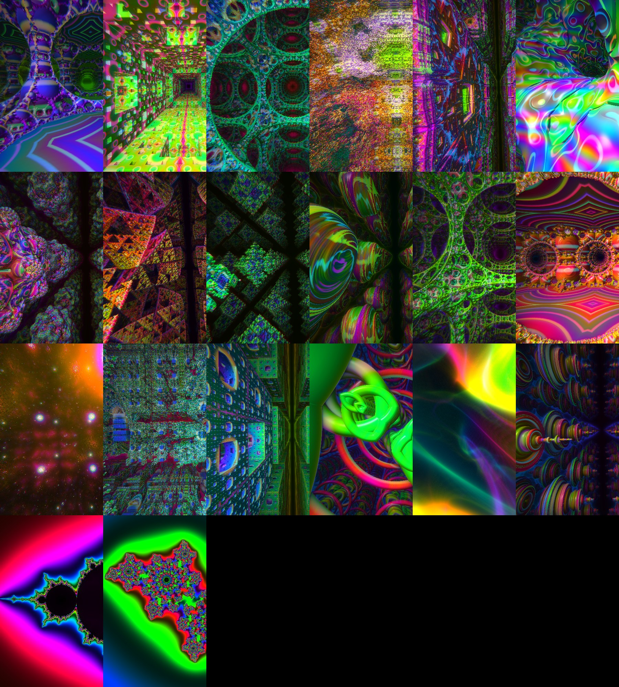

# Mirrorfold

Fly through endless fractal worlds in your browser. Seventeen worlds, kaleidoscope mirrors, feedback trails, filters, overlays, and an autopilot that reacts to music.

This project is inspired in part by the music visualizers from decades past… from Winamp plugins to the standalone visualizer MilkDrop. This has a familiar feel when in Journey mode (an autopilot that flies through the procedurally generated 3D worlds) while listening to music. 

However, this is much more. Flying through fractal 3D landscapes, unlocking features by flying through Orbs, and tweaking so many settings is a relaxing and beautiful time sink, whether on your phone or PC. 

Support for Google Cardboard like VR is also in development (very early stage) and full VR support for true VR headsets is on the way. 

You can Cast or AirPlay your mobile device to your TV as well. 

This is under active development so don’t be surprised if things change from underneath you when I get a hankering for new features. 

Report bugs and discuss features and whatnot in GitHub issues. I’ll try to address them in a timely fashion but this is a small creative side project that itches a scratch for me and I just thought I’d share it with the world. 

Relax, unwind, and enjoy!

**Try it: https://gcrabtree.github.io/MirrorFold/**



The whole app is one file, `index.html`. There is no build step and no JavaScript dependency. It uses WebGL 1, so it runs in any current browser on a phone or a desktop.

## Contents

- [What it does](#what-it-does)
- [Run it](#run-it)
- [Controls](#controls)
- [The buttons](#the-buttons)
- [The land](#the-land)
- [On a TV](#on-a-tv)
- [VR viewer](#vr-viewer)
- [Music](#music)
- [Journey](#journey)
- [Orbs and share links](#orbs-and-share-links)
- [Performance](#performance)
- [Motion and privacy](#motion-and-privacy)
- [How it works](#how-it-works)
- [Developing](#developing)
- [What has not been tested](#what-has-not-been-tested)
- [Licence](#licence)

## What it does

- **17 worlds.** Fifteen are solid fractal surfaces; two (Nebula and Aurora) are glowing volumes. Every world repeats forever in all directions.
- **Free flight** in any direction, with roll. Your speed drops as you approach a surface, so you can never hit a wall.
- **Morph.** Each world slowly changes shape as you fly.
- **Kaleidoscope mirrors**: off, or 3, 4, 6, 8 or 12 segments.
- **13 colour palettes.** Seven are available from the start. Six are unlocked by finding orbs.
- **6 feedback motions, 17 filters, 7 overlays and 8 transitions**, in the style of the MilkDrop music visualiser.
- **Music reactivity** from a built-in track, your own audio file, another browser tab such as Spotify or YouTube, the microphone, or a tapped tempo.
- **Journey**, an autopilot that flies for you and changes the world, palette, mirrors, motion, filter and overlay over time. You control what it may change with templates.
- **Share spot** links that take someone to the exact place you are looking at.
- **VR viewer** mode for a phone in a Cardboard-style holder: a picture for each eye, and you look around by turning your head.

The worlds, in menu order: Lattice, Sponge, Halls, Box, Citadel, Coral, Bulbs, Shards, Crystal, Julia, Web, Temple, Nebula, Fortress, Hive, Gates, Aurora.

## Run it

**Online:** open https://gcrabtree.github.io/MirrorFold/.

**From a copy of this repository:** open `index.html` in a browser. It works straight from the file system.

**From a local web server:**

```
python3 -m http.server 8000
```

Then open http://localhost:8000/.

**Host your own copy:** put `index.html` on any static web host. For GitHub Pages, keep `index.html` at the root of the published branch and keep the empty `.nojekyll` file, which stops Pages from running Jekyll over the repository.

On the start card, choose **Enter with music** or **Enter silent**.

### Full screen

On a desktop, Android or iPad, press the **Fullscreen** button.

Safari on iPhone does not let a web page go full screen, so the button is hidden there. Instead, add Mirrorfold to your home screen: open the site in Safari, press the Share button, then **Add to Home Screen**. Opening it from the new icon runs it without Safari's bars. The home-screen copy keeps its own saved templates and orb progress, separate from Safari's; save a pack file from the Library to move templates across.

## Controls

### Phone or tablet

| Action | Gesture |
|---|---|
| Move | Left thumb, anywhere in the left 45% of the screen. A ring appears under your thumb. |
| Look | Right thumb, anywhere else. |
| Change speed | Two fingers on the right side, pinch. |
| Roll | Two fingers on the right side, twist. |
| Burst of speed | Double-tap on the right side. |

### Mouse and keyboard

Click the picture to capture the mouse. Where the browser does not allow that, drag to look.

| Action | Key |
|---|---|
| Fly | `W` `A` `S` `D` |
| Up, down | `Space`, `Shift` |
| Roll | `Q`, `E` |
| Look | Mouse, or arrow keys |
| Change speed | Mouse wheel |
| Burst of speed | `B`, or double-click |
| Next or previous world | `]`, `[` |
| Jump to one of the first nine worlds | `1` to `9` |
| Next palette | `P` |
| Next mirror setting | `M` |
| Journey on or off | `J` |
| Tap tempo | `T` |

The controls at the top of the screen fade after five seconds without input and come back on any touch or click.

## The buttons

**First row:** World, Palette and Music.

**Second row:**

| Control | Options |
|---|---|
| Feedback motion | none, Melt, Vortex, Tunnel, Implode, Ripple, Drift. Each one smears the previous frame in a different way. |
| Filter | none, Echo, Neon, Solar, Negative, Poster, Mosaic, Liquid, Prism, Quad, Tiles, Bulge, Twirl, Thermal, CRT, Halftone, Contour, Noir. |
| Overlay | none, Ring, Scope, Spectrum, Spokes, Rings, Spiral, Orbit. These draw the sound on top of the picture. |
| Overlay strength | 15%, 30%, 50%, 75% or 100%. |

**Third row:**

| Button | What it does |
|---|---|
| Journey | Turns the autopilot on or off. |
| Mirrors | Steps through off, 3, 4, 6, 8 and 12 segments. |
| Land | Steps through **Land off**, **Land alone** and **Land over world**. See [The land](#the-land). |
| Land is | Shown while the land is on. Steps through the landscapes: **the Alps**, **canyon country** and **a strange planet**. |
| Land colours | Shown while the land is on. **Land colours natural**, **Palette on sky and light**, or **Palette on everything**. |
| Effects on | Shown for **Land over world**. Whether motions, filters and overlays act on **everything**, **the sky** (the world behind) or **the land**. |
| FX | Steps through glow, trails and clean. Sets the base amount of trail and bloom. |
| Detail | Steps through auto, sharp and fast. See [Performance](#performance). |
| Morph | Turns the slow change of each world's shape on or off. |
| Drift | Turns the slow forward drift on or off when you are not steering. The drift nearly stops while you turn the view, and picks up again when you stop. |
| Orbs | Shows or hides the orbs. |
| Share spot | Makes a link to where you are. |
| Fullscreen | Fills the screen. |
| Help and source | Opens this page on GitHub in a new tab. |
| VR viewer | Phones and tablets only. Draws a picture for each eye, for a phone in a viewer. See [VR viewer](#vr-viewer). |

## The land

The land is an endless landscape you fly over. **Land is** chooses which one:

- **The Alps**: snow peaks, glaciers, waterfalls and streams, lakes, meadows and conifer forest. From far off a forest is a dark patch. Close up it becomes separate trees, and meadows gain bushes and boulders.
- **Canyon country**: a plateau of banded red rock cut by stepped gorges with a river at the bottom, with mesas and buttes standing on the plain, and rock arches and balanced rocks. You can fly under the arches.
- **A strange planet**: sharp peaks over rippled plains, veins of light in the ground, glowing pools, glowing horns and bulbs, and crystals, rings and slabs that float and turn slowly in the air. Land alone gives it a dark sky with stars and a ringed planet.

Each landscape can be shown two ways:

- **Land alone** shows the land under its own sky. No world is drawn.
- **Land over world** shows the land with the current world as the sky. Water mirrors the world, and far land thins into it. The world is only drawn where the land leaves it showing.

You fly over the land the same way as through a world: the stick, **W A S D**, **Drift** and **Journey** all move you forward the way you face, and the land keeps you clear of the ground. **Space** and **Shift** raise and lower how high you fly. With Journey movement set to travel, the autopilot follows the valleys. The horizon is kept level. You are pushed gently aside if you fly into an arch or a floating shape.

**Land colours** decides what the palette does: nothing, tint the sky, sun and haze, or recolour the land and water as well. Mirrors apply to the land. **Effects on** decides what the motion, filter and overlay act on when the land is over a world.

The land is the heaviest thing Mirrorfold draws. With **Detail auto** it may lower the sharpness further than a world does. It is switched off in the VR viewer, and Journey templates do not yet turn it on or off.

## On a TV

Roku, Apple TV and other TV boxes cannot run Mirrorfold themselves, and there is no app or channel for them. You can still watch it on a TV by mirroring the screen of a phone, tablet or computer: AirPlay from an iPhone, iPad or Mac, and Cast or screen mirroring from Android.

[`docs/TV.md`](docs/TV.md) has step-by-step instructions for Apple TV, Roku, Chromecast, Google TV, Fire TV and smart TVs, a table of which phone works with which device, and fixes for common problems.

## VR viewer

This mode is for a phone in a Cardboard-style viewer: a holder with two lenses that you look into. It has not been tried on a real phone or viewer yet, so treat it as experimental.

1. Open Mirrorfold on the phone. On iPhone, open it from the home-screen icon so Safari's bars are out of the way (see [Full screen](#full-screen)).
2. Choose what you want first: world, palette, music, and Journey or Drift.
3. Press **VR viewer**. On iPhone, allow motion access when asked.
4. Turn the phone sideways and put it in the viewer.

Turning your head turns the view. With **Drift** on you glide toward wherever you look, and the glide nearly stops while your head is turning. With **Journey** on and **Movement travel**, the autopilot also steers, and it stops steering while your head is turning. With **Movement drift**, Journey changes the worlds and leaves all the turning to you. Touch still works: tap the screen to bring the controls back, and press **VR viewer** again to leave. The screen is kept awake while the mode is on, where the browser allows it.

While the mode is on:

- Feedback motions, trails and overlays are not drawn. They are centred on the screen, not on each eye.
- These filters are not drawn, for the same reason: Echo, Mosaic, Liquid, Prism, Quad, Tiles, Bulge, Twirl. The others work.
- Changes of world always use the blink transition.
- The slow automatic roll is off.
- Mirrors work, and both eyes see the same mirrored scene.

The picture is shaped for the lenses of a Google Cardboard viewer (lenses 64 mm apart, 39 mm from the screen). A browser cannot find out how big the screen is, so the size is estimated. If the two pictures do not merge into one, or the world looks stretched, please open an issue and say which phone and viewer you used.

If moving through the world makes you feel unwell, stop. **Movement drift** is gentler than travel, because then the view only turns when your head does.

## Music

Three bands of the sound drive different parts of the picture. Bass drives zoom kicks, bloom and flight speed. Mids drive the morph speed, rotation and the bands on surfaces. Treble drives highlights, colour fringing and how fast the colours drift.

| Setting | What it does |
|---|---|
| Built-in music | A generated track at 92 beats per minute. It is made in the browser, not a recording. |
| My audio file | Plays a file you choose, with pause and a scrubber. Files longer than 15 minutes or larger than 80 MB are streamed instead of loaded whole. |
| Tap tempo | Makes no sound. Use it when music is playing in another app, such as Apple Music or Spotify: enter silent, start your song there, choose Tap tempo and tap the beat. |
| Listen to a tab | Reacts to the sound of another browser tab, such as Spotify's web player or YouTube. Chrome and Edge on a computer only. |
| Microphone | Reacts to whatever the microphone hears in the room. |
| Music off | The worlds still move, without reacting to sound. |

### Music from Spotify, YouTube or another tab

This works in Chrome and Edge on a computer. Other browsers do not show the option.

1. Start the music in another tab of the same browser.
2. In Mirrorfold, set Music to **Listen to a tab**.
3. The browser asks what to share. Choose the tab with the music, and turn on **Also share tab audio**.

The music keeps playing from its own tab, and Mirrorfold only listens. To stop, change the Music setting or press the browser's **Stop sharing** button. The browser asks again each time.

The source has to be a browser tab, so use Spotify's web player, not the Spotify app. On Windows you can choose **Entire screen** with system audio to hear any app. It has been tested with a simulated share only; if Spotify's web player gives no reaction, please open an issue.

### Microphone

Set Music to **Microphone** and allow access when the browser asks. Mirrorfold reacts to what the microphone hears: speakers in the room, the Spotify app, an instrument. It works in any browser that has a microphone, but the signal is rougher than a shared tab and it also reacts to talking. On a phone, the browser may quieten or stop music playing from another app while the microphone is in use; if it does, use Tap tempo.

While listening to a tab or the microphone, Mirrorfold plays no sound of its own. The sound is analysed in your browser as it arrives. It is not recorded, stored or sent anywhere.

For music Mirrorfold cannot hear at all, use Tap tempo.

## Journey

Journey flies for you. It steers toward open space and changes things on separate clocks, so no two minutes are the same. While Journey is on, the screen is kept awake, where the browser allows it.

With Journey on, a **Movement** button appears beside the template list:

| Setting | What it does |
|---|---|
| Movement travel | Journey flies and steers for you. This is the default. |
| Movement drift | Journey only changes the scenery: world, palette, mirrors, motion, filter and overlay. It does not move or turn you. You fly yourself, and the **Drift** button decides whether you glide slowly forward when you are not steering. |

In both settings you can take over at any moment. While you turn the view, by dragging, with the arrow keys, or by turning your head in the VR viewer, the autopilot stops steering and the automatic forward motion nearly stops. About a second after you stop turning, it carries on from where you are looking. The choice of travel or drift is remembered in your browser.

A **template** says what Journey may change and how often. For each of world, palette, mirrors, motion, filter and overlay you choose whether it changes, how many seconds between changes, and which options are allowed. Worlds can also change when the music changes instead of on a clock.

A **set** plays several templates in turn, each for a number of minutes.

Built-in templates: Classic, Everything, Clean flight, MilkDrop, Kaleidoscope, Calm, Follow the music. Built-in set: Grand tour.

Turn Journey on and press **Edit journeys** to make your own. Built-in templates cannot be edited; use **Duplicate** to start from one. Your templates and sets are saved in your browser only. To keep a copy or move them to another device, save them as a pack; see [Library and packs](#library-and-packs).

## Library and packs

A **pack** is a small file of palettes, motions, filters, overlays, Journey templates and sets. Almost all of it is names and numbers, which Mirrorfold checks and pulls back into range. A filter or overlay may also hold a short picture program for the graphics chip. Such a program cannot reach the page, your files or the network, and Mirrorfold refuses it unless it keeps to a strict set of rules. Nothing in a pack is ever run as JavaScript.

Programs in packs published with Mirrorfold have been reviewed. A program you load from a file or paste as text has not, so while it is in use Mirrorfold shows the picture smoothed over time, which makes it impossible for it to flash the screen. The Library list marks those items.

Press **Library** to open the library section of the setup panel:

| Control | What it does |
|---|---|
| **Add this pack** | Adds the chosen pack from the ones published with Mirrorfold. This list is missing when the page is opened straight from a file. |
| **Load a pack file** | Adds a pack from a file on your device. |
| **Save mine as a pack file** | Saves everything you have added or made as one pack file, to keep or to share. |
| **New palette**, **New motion**, **New filter** | Makes a copy of what is showing now and opens the editor on it. |
| **Edit** | Opens the editor on one added palette, motion or filter. |
| **Remove** | Removes one added item. |
| **Copy mine as text**, **Load from text** | The same as saving and loading a file, through the text box. |

Added palettes, motions, filters and overlays appear at the end of their lists and in the Journey template editor. They are saved in your browser only.

### Making your own

The editor is a sheet of controls along the bottom of the screen, or down the right side on a phone held sideways. The picture stays in view beside it and changes as you move a control, and every change is saved at once. Type a name, press **Help** to read what each control does, and press **Done** to close it.

| Editor | Controls |
|---|---|
| Palette | First colour and Second colour, which the palette runs between, then Colour changes, Slide and Rainbow. A strip shows the whole palette. **Fine tuning** opens Level, Range, Waves and Offset, each for red, green and blue. |
| Motion | Trail length, Zoom, Turn, Swirl, Wobble, Ripple, Slide sideways, Slide up or down, Beat push |
| Filter | Outlines, Brightness steps, Solarise, Negative, Echo, Mosaic blocks, Liquid, Colour turn, Colour fringing, Built-in effect |

Sliders stop at the same limits a pack is held to. Filter and overlay programs are written by hand; there is no editor for those.

Worlds cannot be put in a pack yet. The file format, the allowed ranges and how to offer a pack for inclusion are in [packs/README.md](packs/README.md).

## Orbs and share links

Each world hides a glowing orb. Fly into it to collect it. The first six orbs each unlock a new palette. After that, collecting an orb takes you to another world. Progress is saved in your browser.

**Share spot** makes a link that records the world, palette, mirror setting, your position, the direction you are facing and the world's current shape. Opening the link puts the viewer in the same place. Roll is not recorded.

A link ending in `#` and a world id opens that world, for example https://gcrabtree.github.io/MirrorFold/#julia. The ids are the world names in lower case.

## Performance

Every pixel is computed by stepping a ray through a fractal, which is heavy work for a graphics chip. The **Detail** button trades sharpness for speed:

| Mode | Behaviour |
|---|---|
| auto | Starts at 85% resolution and adjusts between 60% and 100% to hold the frame rate. This is the default. |
| sharp | Full resolution, up to three device pixels per CSS pixel. |
| fast | Half resolution. |

Bulbs, Julia, Box and Fortress are the heaviest worlds. If the picture stutters, try **Detail fast** or **FX clean**.

## Motion and privacy

**Motion.** Colour and motion shift constantly. Pulses are soft and slow by design and nothing strobes; a tapped tempo above about 165 beats per minute is halved. If your device is set to reduce motion, all reactions to sound are cut to a quarter and several motions are disabled.

**Privacy.** Mirrorfold makes no network requests of its own. The page loads two fonts from Google Fonts, and that is all. The VR viewer reads the phone's motion sensor to follow your head; the readings stay on the phone. **Listen to a tab** and **Microphone** only run when you choose them and the browser's permission prompt is accepted; the sound is analysed in the browser and never recorded or sent. An audio file you choose is read by your browser and is not uploaded. Templates, orb progress and the orbs setting are kept in your browser's local storage.

## How it works

Each frame draws five passes:

1. **Scene.** A fragment shader marches one ray per pixel through a distance estimator for the current world (sphere tracing). Mirrors fold the ray direction, so the kaleidoscope is a true view of a 3D scene and not a folded image.
2. **Feedback.** The previous frame is warped, faded and combined with the new one. This gives the trails and motions.
3. **Bloom.** A bright pass is blurred at quarter resolution.
4. **Final.** Filters, colour fringing, bloom and transitions are applied on the way to the screen.

Each world's distance estimator is written twice: once in GLSL for drawing, and once in JavaScript so the app can scale flight speed, steer the autopilot and place orbs. Every world is exactly periodic, and the camera position is wrapped by that period each frame to keep floating-point precision.

Sound goes through one Web Audio analyser. Three bands each keep a level and a soft pulse. A change detector compares short and long averages to decide when the music has changed enough to change world.

[`docs/ARCHITECTURE.md`](docs/ARCHITECTURE.md) covers all of this in detail: the render pipeline, the math of every world, the audio analysis, the journey engine, known weaknesses, ideas not yet built and a suggested split into modules.

## Developing

### Files

| Path | What it is |
|---|---|
| `index.html` | The app: markup, CSS, GLSL and JavaScript, about 2,700 lines |
| `docs/ARCHITECTURE.md` | How it works, in detail |
| `docs/TV.md` | How to show Mirrorfold on a TV by screen mirroring |
| `docs/worlds.jpg` | Contact sheet of all 17 worlds |
| `packs/` | Packs published with the site, the list of them (`index.json`) and the pack format (`README.md`) |
| `tools/unit.mjs` | Tests for the change detector, the weighted picker, the head-turn math, the steering handoff and the pack cleaners |
| `tools/pack.mjs` | Checks pack files with the same code the app uses |
| `tools/check.py` | Headless smoke test |
| `tools/render.py` | Headless screenshots |
| `tools/harness.py` | Shared code for the two Python tools |
| `CLAUDE.md` | Working notes for Claude Code sessions |
| `apple-touch-icon.png` | Icon used when the site is added to a phone's home screen |
| `.github/workflows/check.yml` | Runs the Node checks on every push and pull request |
| `.nojekyll` | Stops GitHub Pages from running Jekyll |

### Tests and tools

```
node tools/unit.mjs                     # pure-logic tests
node tools/pack.mjs                     # check every pack in packs/
```

GitHub runs `unit.mjs` and `pack.mjs` on every push and pull request (`.github/workflows/check.yml`). The browser tools below are run by hand:

```
python3 tools/check.py                  # all shaders compile, no script or WebGL errors
python3 tools/render.py --world julia -o out.png          # screenshot one world
python3 tools/render.py --all -o sheet.jpg                # contact sheet of every world
python3 tools/render.py --world temple --js "setLook(2)" -o neon.png
```

`unit.mjs` needs Node. The Python tools need `google-chrome` or `chromium` on your PATH; they run it headless with software WebGL. `--all` also needs Pillow.

### Rules that are easy to break

- A world's GLSL `map` and JavaScript `de` must compute the same distance. If they drift apart, the camera clips through walls or crawls in open space.
- A world's field must repeat exactly at its `period`, or the camera wrap shows as a jump.
- Journey templates store options by name. Renaming a world id, motion, filter, overlay or palette silently removes it from people's saved templates.
- The tools find code in `index.html` by exact strings and by function name. If you restructure the script, update the tools in the same change.
- After any shader change, run `check.py`, then render the affected world and look at it. Shaders can compile cleanly and still look wrong.

The code is ES5 in one closure: `var`, function declarations, no modules. Shaders are GLSL ES 1.00. The architecture document has a checklist for adding a world.

## What has not been tested

The app was developed against headless Chrome with software rendering. These have not been checked on a real device:

- Frame rate on phones.
- Multi-touch gestures. The twist direction may feel reversed.
- How the built-in music sounds, and how strong each reaction should be.
- The change detector on real songs.
- Seeking in files over 15 minutes on iOS.
- Whether iOS keeps another app's music playing in Tap tempo mode.
- Typing in the journey editor on iOS.
- The home-screen full-screen mode on iPhone, including whether the controls clear the notch.
- The screen mirroring steps in `docs/TV.md`, on any TV device.
- Whether the screen really stays awake with Journey or the VR viewer on, in Safari and from the home-screen icon.
- **Listen to a tab** with real Spotify and YouTube tabs, and **Microphone** with a real microphone. Both were tested with simulated devices only.
- The VR viewer mode: whether the two pictures merge in a real viewer, whether head turning goes the right way, and whether it is comfortable.

Known weak spots: Box and Fortress look grainy, and the controls cover a lot of a phone screen until they fade. Reports from real devices are welcome as issues.

## Licence

[MIT](LICENSE).
